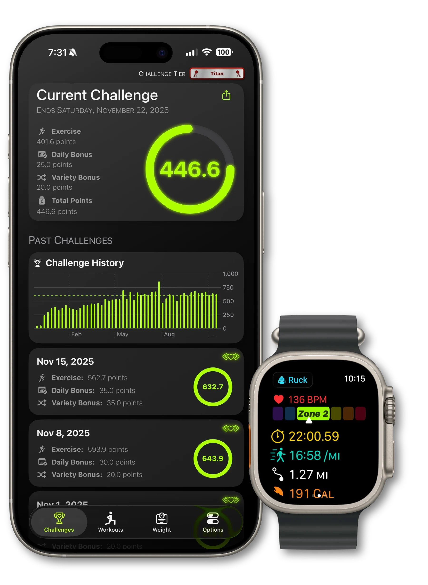
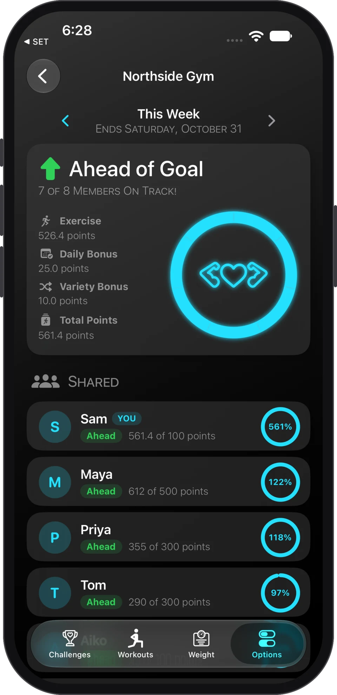
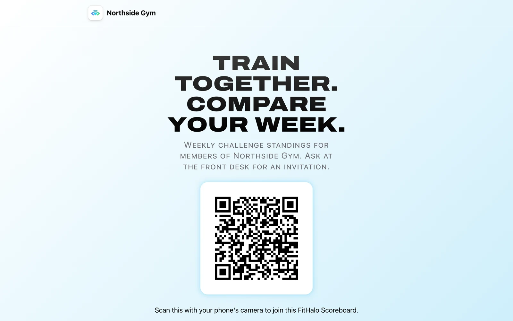
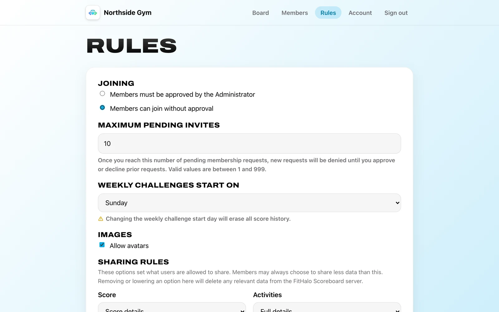

# FitHalo Scoreboards

FitHalo Scoreboards is a small, self-hosted server that lets a group of people who use the
[FitHalo](https://fithalo.app) fitness app follow each other's weekly progress. A gym, a workplace, or a
group of friends runs one scoreboard for themselves. FitHalo's developer does not host, list, relay, or
see any user-created scoreboards. Each member of a scoreboard decides how much of their weekly activity
the scoreboard receives, from a single percentage up to workout routes and the weights lifted.

This document covers the whole project: what FitHalo and a scoreboard are, how to deploy a scoreboard
on each supported host, the API and storage specifications, the security model, and how to build the
server from source.

## Contents

1. [Introduction](#1-introduction)
   1. [FitHalo](#11-fithalo)
   2. [Scoreboards](#12-scoreboards)
   3. [Privacy Standards](#13-privacy-standards)
   4. [Design Principles](#14-design-principles)
2. [Deployment Instructions](#2-deployment-instructions)
   1. [AWS Free Tier](#21-aws-free-tier)
   2. [Azure Free Tier](#22-azure-free-tier)
   3. [Raspberry Pi](#23-raspberry-pi)
   4. [Docker](#24-docker)
3. [Open API and Specifications](#3-open-api-and-specifications)
4. [Security and Authentication](#4-security-and-authentication)
5. [Building and Testing from Source Code](#5-building-and-testing-from-source-code)

## 1. Introduction

### 1.1 FitHalo

<div align="center">
<figure>

<figcaption>FitHalo on an iPhone and an Apple Watch</figcaption>
</figure>
</div>

FitHalo is a free fitness app for iPhone, Apple Watch, and Android. FitHalo collects no personal data:
all health and workout information stays on the phone. The FitHalo website:
[https://fithalo.app](https://fithalo.app).

- [FitHalo on the App Store](https://apps.apple.com/app/fithalo/id6736888802)
- [FitHalo on Google Play](https://play.google.com/store/apps/details?id=com.jacobjohnston.fithalo)

FitHalo combines all of a person's workouts into one weekly score, the FitHalo Score. Any workout saved
to the phone's health data counts, whether FitHalo, the watch's own workout app, or another fitness app
recorded the workout. Each workout earns points for duration or distance, with extra points for a raised
heart rate. A daily bonus rewards working out on more days of the week, and a variety bonus rewards
mixing different kinds of activity. The week's total is measured against a goal the person chooses by
picking a challenge tier, from Beginner at 100 points to Deity at 1,000 points. One week's score, goal,
and workouts together are called a weekly challenge, and a weekly challenge is what a member shares with
a scoreboard.

<div align="center">
<figure>

<figcaption>A scoreboard in the FitHalo app, with the week's standings</figcaption>
</figure>
</div>

### 1.2 Scoreboards

A FitHalo Scoreboard is one running copy of this server, called a scoreboard in this document. A
scoreboard lets friends, family, coaches, and trainers follow each other's activities and FitHalo Scores.
Scoreboards are operated independently by individual members of the FitHalo community. FitHalo's
developer does not host, list, relay, or see any user-created scoreboards.

Three roles appear in this document:

| Role | Meaning |
|---|---|
| Operator | The person who deploys the server and keeps the server running. The operator controls the machine or cloud account the scoreboard runs on, the scoreboard's data, and the scoreboard's configuration |
| Admin | The one account on the scoreboard's web portal. The admin configures the scoreboard, approves and removes members, and manages the invitation link. The operator and the admin are usually the same person |
| Member | A FitHalo user who joined the scoreboard from the FitHalo app. The admin can allow individual members to approve or reject new members from the app |

A scoreboard has three sections:

| Section | Address | Purpose |
|---|---|---|
| The API | `/api/v1` | What the FitHalo apps communicate with. The API is defined in [`openapi.yaml`](openapi.yaml) |
| The landing page | `/` | A public-facing page that provides a description and invitation link to the scoreboard |
| The admin portal | `/admin` | Provides configuration options and member management tools for the scoreboard |

<div align="center">
<figure>

<figcaption>The landing page, with the scoreboard's description and invitation QR code</figcaption>
</figure>
</div>

<div align="center">
<figure>

<figcaption>The admin portal's Rules page</figcaption>
</figure>
</div>

A member joins a scoreboard from an invitation link or the link's QR code, which the admin finds in the
portal. The FitHalo app opens the link, shows the scoreboard's name and settings, asks the member for a
display name and a sharing choice, and joins. After each workout, FitHalo uploads the member's current
weekly challenge to the scoreboard at the sharing level the member chose. The scoreboard ranks all active
members' weekly challenges for the current week, and retains past weeks for as long as the admin's
retention setting allows.

### 1.3 Privacy Standards

A scoreboard may hold information about fitness activities that members consider sensitive and do not
want shared publicly. The server is built around the following standards. Each standard is enforced in
code and covered by the tests.

- There is no central scoreboard service hosted by FitHalo. Scoreboards are small, community-based
  instances for small groups of friends or family members. A scoreboard's data is stored only on the
  operator's own machine or cloud account.
- Members are authenticated by a cryptographic key pair rather than by a username and password. The
  private key stays on the member's phone, and the scoreboard stores only the public key. A copy of the
  scoreboard's data therefore contains nothing that could be used to impersonate a member.
- Members have fine-grained control over what is shared. Each member chooses a sharing level for each
  scoreboard, from a single progress percentage up to full workout details, routes, and weights. The
  FitHalo app never sends data above the level the member chose.
- The admin sets a maximum sharing level for the scoreboard. The server enforces the lower of the
  member's choice and the admin's maximum. Any field above that level in an upload, for example from an
  outdated app or after the admin lowered the maximum, is removed before storage, and the server's
  response shows what was stored.
- Lowering a sharing level deletes data. When a member lowers their sharing, or the admin lowers the
  scoreboard's maximum, the server deletes all stored data above the new level before answering the
  request.
- Leaving deletes everything. A member who leaves, or whom the admin removes, is deleted along with their
  avatar, all weekly challenges, and all routes.
- Route start and end points are removed before upload. The FitHalo app removes all points within 400
  metres of a route's first and last points, and offsets the centre of the removed circle by a
  per-scoreboard amount, so the true start cannot be recovered by comparing many routes. The server
  never receives the removed points.
- Avatars are stripped of metadata. The server decodes each uploaded image and re-encodes the image as
  JPEG, which removes EXIF and location metadata.
- A member cannot be matched across scoreboards. The member's key, member identifier, activity
  identifiers, and route offset are derived separately for each scoreboard, so two scoreboards cannot
  determine that the same person is a member of both.
- Members choose the name shown on a scoreboard. The FitHalo app asks for a display name when a
  member joins, and the member can change the display name at any time. FitHalo never sends a member's
  real name, and FitHalo has no account from which a name could be taken.
- Some data is never sent at any sharing level: a workout's title, the app that recorded the workout,
  the member's date of birth, medication settings, and anything else FitHalo knows beyond the fields
  listed in [`spec/sharing.json`](spec/sharing.json).

The sharing levels, the admin's maximum, and what the server does when a level changes are specified in
[`docs/specifications.md`](docs/specifications.md#sharing).

### 1.4 Design Principles

- No central service. The operator of a scoreboard owns the server and all data on the server.
- No dependencies. The server is written in Go and uses only Go's standard library.
  [`go.mod`](go.mod) has no `require` lines. The whole server is small enough to read and audit in an
  afternoon.
- A copy of the data is not enough to impersonate anyone. Members are identified by public keys, and the
  admin's password hash uses a secret stored outside the data, so a copy of the data alone cannot be used
  to act as a member or to sign in as the admin.
- Simple to host. Each supported host is one script to run or one template to launch, and each
  deployment guide ends with a scoreboard the FitHalo app can join. The server runs on AWS's and Azure's
  free tiers, on a Raspberry Pi, and anywhere Docker runs.
- Sharing is enforced twice: by the FitHalo app before upload, and by the server before storage.
- Compatibility across versions. Scoreboards and apps update separately, so all apps work with older and
  newer scoreboards, and all scoreboards with older and newer apps. [Versions](docs/specifications.md#versions)
  describes how.
- Stored data is a contract between releases. Each later server reads the data an earlier release stored,
  and fixtures in the tests prove the compatibility. The [storage specification](docs/specifications.md#storage-specification)
  describes the layout.

## 2. Deployment Instructions

Four hosts are supported. Each one ends with the same scoreboard, reachable over HTTPS, with an admin
account and a working invitation link.

| Host | What runs the scoreboard | What stores the data | Monthly cost for a small scoreboard | Time to deploy |
|---|---|---|---|---|
| [AWS](#21-aws-free-tier) | A Lambda function behind a function URL | A DynamoDB table | Nothing, within AWS's permanent free allowances | About fifteen minutes, with no software on the operator's computer |
| [Azure](#22-azure-free-tier) | A container app that sleeps between visits | A Cosmos DB account on the free tier | Nothing, within Azure's permanent free allowances | About twenty minutes, with no software on the operator's computer |
| [Raspberry Pi](#23-raspberry-pi) | A systemd service on the Pi or any Linux machine | A directory on the Pi | The Pi's electricity, and a domain where one is used | About half an hour |
| [Docker](#24-docker) | A container on any machine with Docker | A Docker volume | Whatever the machine costs | About fifteen minutes |

Each deployment goes through the same four stages: deploy the server, which prints a setup code; reach
the scoreboard over HTTPS; create the admin account at `/admin/setup` with the setup code; and run the
`check` subcommand against the scoreboard. Each guide below covers the four stages for one host, the
secrets the host keeps outside the data, the configuration the host uses, and how to update, back up,
and recover the scoreboard.

### 2.1 AWS Free Tier

Full guide: [`docs/aws.md`](docs/aws.md).

A Lambda function runs the scoreboard behind a function URL, which provides the HTTPS address, and a
DynamoDB table stores the data. Both stay inside the allowances AWS keeps free permanently. The
deployment runs from AWS CloudShell: one script downloads the latest release, verifies the release's
checksums and build attestations, creates a CloudFormation stack, and prints the scoreboard's address and
setup code. Running the script again updates the scoreboard. The guide also covers a custom domain
through CloudFront and what changes behind CloudFront.

### 2.2 Azure Free Tier

Full guide: [`docs/azure.md`](docs/azure.md).

A container app runs the scoreboard and sleeps between visits, and a Cosmos DB account on the free tier
stores the data. Container Apps ingress provides the HTTPS address. The deployment runs from Azure Cloud
Shell: one script downloads the release's template, verifies the template, deploys the scoreboard from
the container image the template names by digest, and prints the scoreboard's address and setup code.
Running the script again moves the scoreboard to the latest image without touching the secrets.

### 2.3 Raspberry Pi

Full guide: [`docs/raspberry-pi.md`](docs/raspberry-pi.md).

An installer puts the scoreboard on a Raspberry Pi, or any Linux machine with systemd, as a hardened
service with the data in a directory. Phones outside the home network reach the Pi through Tailscale
Funnel, Cloudflare Tunnel, or a forwarded port with a certificate from certbot; the guide compares the
three and walks through each. The same release and steps apply to a free cloud machine from Oracle or
Google.

### 2.4 Docker

Full guide: [`docs/docker.md`](docs/docker.md).

A container image built from the repository runs the scoreboard with the data in a Docker volume. As
shipped, the compose file publishes the scoreboard on the machine's loopback address for a tunnel or
reverse proxy that terminates TLS; the container can also serve TLS itself from a mounted certificate.
The guide covers Docker Compose, `docker run`, and the trusted-proxy settings a container needs.

## 3. Open API and Specifications

Full document: [`docs/specifications.md`](docs/specifications.md).

Three files define the contract between a scoreboard and the FitHalo apps. The server enforces exactly
these files, and the apps read the same files.

| File | Content |
|---|---|
| [`openapi.yaml`](openapi.yaml) | The API: all operations, schemas, problem codes, conventions, limits, and the versioning rules. The source of truth for the server and the apps |
| [`spec/sharing.json`](spec/sharing.json) | All weekly challenge data and the sharing each field requires. The server removes fields by this file, and both sides test against this file |
| [`spec/vocabularies.json`](spec/vocabularies.json) | The known activity types, set types, challenge tiers, muscle groups and intensities, modifier kinds, assist modes, and partial ranges |

The specifications document explains the API's operations, conventions, versioning rules, limits, and
problem codes; the sharing model the files encode; and the layout of stored data, which is a contract
between releases of the server.

## 4. Security and Authentication

### Member authentication

Members are authenticated by an ECDSA key pair on the P-256 curve rather than by a username and
password. The private key stays on the member's phone, and the scoreboard stores only the public key.
All requests except `GET /board` and `GET /board/avatar` are signed with the private key, so nothing the
scoreboard stores, and nothing that leaks from the scoreboard, can be used to act as a member.

This section is the contract all clients and servers follow. [How FitHalo derives its keys](#how-fithalo-derives-its-keys)
describes FitHalo's own key derivation, which only matters to FitHalo.

#### Keys and identifiers

| Value | Form |
|---|---|
| The key | An ECDSA key on P-256 (`secp256r1`). The public key travels as the 65-byte uncompressed SEC 1 point (`0x04 ‖ X ‖ Y`) in unpadded base64url: 87 characters |
| The member's identifier | The first 16 bytes of the SHA-256 of those 65 bytes, in unpadded base64url: 22 characters. The server computes the identifier from the key, so an identifier can only ever belong to the key the identifier came from |

#### The header

```
Authorization: FitHalo-ECDSA member=<MemberID>,time=<time>,nonce=<nonce>,signature=<signature>
```

| Parameter | Value |
|---|---|
| `member` | The member's identifier |
| `time` | When the request was signed, in whole seconds since 1970-01-01T00:00:00Z |
| `nonce` | 16 random bytes in unpadded base64url, new for each request, retries included |
| `signature` | The signature, described below |

Parameters are separated by commas, with optional spaces after each comma, and may come in any order.
Each parameter appears exactly once.

#### What is signed

Five lines of UTF-8, joined by a single line feed (`0x0A`), with no line feed after the last:

```
FitHalo-ECDSA-1
<method>
<target>
<time>:<nonce>
<body hash>
```

| Line | Value |
|---|---|
| `FitHalo-ECDSA-1` | Literally, so a signature made for this purpose cannot be mistaken for any other |
| `<method>` | The HTTP method in upper case: `PUT` |
| `<target>` | The path and query exactly as they appear on the request line: `/api/v1/members/me/weekly-challenges/2026-10-19`. A scoreboard served under a path includes the path. A proxy in front of the server must not rewrite the path, or all signatures fail |
| `<time>:<nonce>` | The header's `time` and `nonce`, joined by a colon |
| `<body hash>` | The SHA-256 of the request body in lower-case hex, or of nothing for a request without a body (`e3b0c44298fc1c149afbf4c8996fb92427ae41e4649b934ca495991b7852b855`) |

The signature is ECDSA with SHA-256 over those bytes (`ES256`), sent as `r` and `s`, each 32 bytes
big-endian, concatenated, in unpadded base64url: 86 characters.

#### What the server checks

In this order, answering with the first failure:

1. The header parses, with each parameter once. Otherwise `unauthenticated`.
2. `time` is within 300 seconds of the server's clock. Otherwise `clockSkew`, so a phone with a wrong
   clock gets an answer the phone can act on. This check comes before the member check, so the answer is
   the same for a member and for an identifier the scoreboard does not know.
3. `member` is a member the scoreboard knows, or, on `POST /members`, the identifier of the `publicKey`
   in the body. Otherwise `unauthenticated`.
4. The signature verifies against the member's public key. Otherwise `unauthenticated`.
5. The server has not accepted this `nonce` from this member in the last 600 seconds. Otherwise
   `replayed`. The server then records the nonce.

The signature is checked before the nonce is recorded, so an unsigned request cannot use up a member's
nonces. A nonce is remembered for longer than the time window, so a request cannot be replayed at the
edge of the window. Where several instances of the server run at once, on Lambda for example, the nonces
live in the store rather than in memory, so all instances see them.

#### Joining and leaving

`POST /members` is signed with the key the request registers, which proves the caller has the private
key. A key the scoreboard already knows resumes its existing membership; a new key becomes a member,
`active` or `pending` according to the scoreboard's join mode. Leaving, or being deleted by the admin,
removes the key: the key's signatures stop working at once.

### How FitHalo derives its keys

Nothing in this section is visible to a server, and another client could make its keys any way the
client liked. FitHalo derives everything from one secret so that a new phone signed into the same iCloud
account is already a member of all the person's scoreboards, with nothing to re-enter.

#### The root secret

The root secret is 32 bytes from the system's secure random generator, made the first time the member
joins a scoreboard and stored in the iCloud Keychain, which carries the secret to the member's other
devices encrypted end to end and keeps the secret out of device backups. The root secret is never sent
anywhere, never logged, and never reaches the Watch.

#### The derivations

All derivations are HMAC-SHA256. Each message starts with a fixed ASCII label, followed directly by any
bytes listed after the label; `‖` is concatenation.

| Value | Key | Message | Result |
|---|---|---|---|
| Scoreboard key | Root secret | `FitHalo Scoreboard 1 board` ‖ the scoreboard's `id`, decoded to its 16 bytes ‖ the scoreboard's address as UTF-8, normalised: lower-case scheme and host, any port and path, no trailing slash, query, or fragment (`https://scores.example.com`) | All 32 bytes |
| Private key | Scoreboard key | `FitHalo Scoreboard 1 signing` ‖ one counter byte, from `0x00` | All 32 bytes as a big-endian integer `d`. If `d` is 0 or not below the order of P-256, the counter goes up by one and the HMAC is taken again, which happens about once in four billion keys |
| Activity identifier | Scoreboard key | `FitHalo Scoreboard 1 activity` ‖ the workout's UUID as its 16 bytes, in RFC 9562 order | The first 16 bytes, in unpadded base64url |
| Route offset | Scoreboard key | `FitHalo Scoreboard 1 route offset` | Bytes 0 and 1 as a big-endian bearing, `value / 65536 × 360°`; bytes 2 and 3 as a big-endian distance, `value / 65536 × 100 m` |

All values are keyed by the scoreboard's identifier and the scoreboard's address, so a member on one
scoreboard cannot be recognised on another, and an activity on one scoreboard cannot be matched to the
same activity on another. Identifiers are public to anyone who can reach a scoreboard, so the address is
in the key as well: a scoreboard that answers with another scoreboard's identifier gets a key of its own,
never the member's key for the scoreboard being imitated. As a consequence, a scoreboard that moves to a
new address sees its members as new members, who join again while the admin deletes the memberships left
behind. The private key is derived rather than stored, which is what lets the root secret alone restore
all memberships, and is also why the private key cannot live in the Secure Enclave.

The route offset moves the centre of the circle that [Hide Start and End](docs/specifications.md#hide-start-and-end) removes.

#### Losing the root secret

Whoever has the root secret can act as the member on all of the member's scoreboards. Losing the root
secret costs nothing worse than joining each scoreboard again as a new member, and the admin can delete
the membership left behind.

### The admin account

The admin signs in to the portal at `/admin` with a username and password, or with a passkey.

| Rule | Value |
|---|---|
| Username | 1 to 64 characters, compared after trimming spaces |
| Password | 8 to 1,024 characters, hashed with PBKDF2-HMAC-SHA256 at 600,000 iterations with a 16-byte salt and the pepper |
| Passkeys | Up to 20. The admin may turn the password off once a passkey exists, and may not remove the last passkey while the password is off |
| Sessions | 12 hours. A session is stored under the hash of its token, so the store never contains a usable token, and each form submission must echo the session's CSRF token |
| Passkey ceremonies | 5 minutes to finish |
| Sign-in attempts | 10 at once and 10 a minute per address. Recovery and passkey sign-in stay available while repeated failed attempts keep the password sign-in at its rate limit |

#### The breach check

Each new password, and the password at each successful sign-in, is checked against the Have I Been Pwned
list of breached passwords. Only the first five characters of the password's SHA-1 hash leave the server.
A new password on the list is refused; a sign-in password on the list is flagged in the portal until the
admin replaces the password. When Have I Been Pwned cannot be reached, the server skips the check, logs a
warning, and accepts the password, so an outage never locks the admin out.

#### Admin recovery

A host with a shell runs `fithalo-scoreboard reset-admin`, which prints a code that works once, for 15
minutes, at `/admin/recover`.

A host with no shell sets `SCOREBOARD_RECOVERY_CODE` in the scoreboard's configuration. That code does
not expire, so the variable belongs in the configuration only while the admin is locked out: the operator
sets the variable, enters the value at `/admin/recover`, then removes the variable. Each value works once.
The server refuses a value shorter than 16 characters, and the value should be long and random, for
example the output of `head -c 24 /dev/urandom | base64`, never a word or a reused password.

### Transport security

The server serves in one of three modes, chosen with `SCOREBOARD_TLS`:

| Mode | What the server does | Where the mode is used |
|---|---|---|
| `files` | Serves TLS 1.2 or later from a certificate chain and private key in files, and reloads a renewed certificate on its own within half a minute | A Raspberry Pi with a forwarded port and certbot; Docker with a mounted certificate |
| `proxy` | Serves plain HTTP for a proxy that terminates TLS. The server refuses any request the proxy did not receive over HTTPS, read from `X-Forwarded-Proto`, and answers `421 Misdirected Request` before any operation runs | Tailscale Funnel, Cloudflare Tunnel, Caddy, nginx, Lambda's function URL, Azure's ingress |
| `development` | Serves plain HTTP on localhost only | Running from source on a developer's computer |

The public URL must be `https` in `files` and `proxy` modes. The FitHalo app refuses a scoreboard without
HTTPS, and passkeys require HTTPS.

#### Trusted proxies

In `proxy` mode the server reads the client's address for the rate limits from `X-Forwarded-For`, and
reads whether the request arrived over HTTPS from `X-Forwarded-Proto`. Which peers the server trusts
those headers from depends on the configuration:

| `SCOREBOARD_TRUSTED_PROXIES` | Listen address | Peers trusted |
|---|---|---|
| Unset | Loopback or a specific address | Any peer that reaches the port |
| Unset | All interfaces (`0.0.0.0` or `::`) | Loopback, private, shared (`100.64.0.0/10`), and link-local addresses only. Any other peer is answered with status 421 |
| Addresses or CIDRs, separated by commas | Any | Only those peers. Any other peer is answered with status 421 |
| `any` | Any | All peers, as releases before this default did |

### Rate limits

Each limit is per client address, with a burst that may be used at once and a rate that refills the
burst. A request past the limit is answered with `rateLimited` and a `Retry-After` header.

| Limit | Burst | Rate |
|---|---|---|
| API requests | 120 | 300 a minute |
| Attempts to join | 5 | 10 a minute |
| Admin sign-in attempts | 10 | 10 a minute |

On Lambda, each running copy keeps its own limits in memory, so the limits are looser than on a single
server. Behind CloudFront, the limits apply per edge server address; see [Behind CloudFront](docs/aws.md#behind-cloudfront).

### Request limits and timeouts

The server reads request headers for at most 10 seconds, a whole request for at most 30 seconds, and
writes a response for at most 30 seconds. Headers are limited to 16 KB and bodies to the sizes listed
under [Limits](docs/specifications.md#limits). On shutdown, open requests get 10 seconds to finish.

### Verifying a release

The release workflow attaches GitHub build attestations to each file and to the container image. The
`gh` CLI checks a download or the image against this repository's workflow:

```bash
gh attestation verify fithalo-scoreboard-1.0.0-linux-arm64.tar.gz --repo jacobjohnston/FitHalo-Scoreboards
gh attestation verify oci://ghcr.io/jacobjohnston/fithalo-scoreboards:1.0.0 --repo jacobjohnston/FitHalo-Scoreboards
```

The deploy scripts run the same check when `gh` is installed and signed in, and report the check as
skipped otherwise. Each release also ships `SHA256SUMS`, which the scripts check in all cases.

## 5. Building and Testing from Source Code

### Requirements

Go 1.24 or later, and nothing else. The module has no dependencies.

### Testing

```bash
go test ./...
```

The tests include black-box probes written against the written contracts, concurrency tests, fuzz tests,
and the fixtures described under [Fixtures](docs/specifications.md#fixtures). `go test -race -count=1 ./...` runs the tests
with the race detector and no cache, which takes a few minutes because the admin and password packages
exercise PBKDF2 at its full iteration count.

### Running from source

```bash
go run ./cmd/fithalo-scoreboard -data data
```

The command creates a scoreboard in `data/` on the first run and prints a setup code. The operator opens
`http://localhost:8080/admin/setup`, enters the code, and creates the admin account. In development mode
the server serves plain HTTP on localhost only.

`go run ./cmd/fithalo-scoreboard reset-admin -data data` prints a recovery code when the admin's password
and passkeys are lost. `go run ./cmd/fithalo-scoreboard check -url <scoreboard> -invite <code>`
exercises any running scoreboard through the API and reports what passes.

### Packages

| Package | Purpose |
|---|---|
| `cmd/fithalo-scoreboard` | The command: configuration, the server, the Lambda runtime, `reset-admin`, and `check` |
| `internal/api` | Routing, request signatures, body limits, ETags, and problem details |
| `internal/scoreboard` | The scoreboard: joining, weekly challenges, routes, avatars, sharing enforcement, and retention |
| `internal/sharing` | Sharing levels, effective sharing, and removing fields by `spec/sharing.json` |
| `internal/store` | The store interface; the directory, DynamoDB, and Cosmos DB backends; and the wrapper that compresses each document where compression makes the document smaller |
| `internal/aws` | AWS Signature Version 4, for DynamoDB |
| `internal/lambda` | Lambda's runtime API, for a function URL |
| `internal/nonces` | Nonces stored in the store, for many instances |
| `internal/auth` | The `FitHalo-ECDSA` signature |
| `internal/password` | PBKDF2-HMAC-SHA256 with an optional pepper, and the Have I Been Pwned check |
| `internal/web` | The landing page and the admin portal, in ten languages |
| `internal/admin` | The admin's account, sessions, and recovery |
| `internal/webauthn` | Passkeys, with the small CBOR decoder passkeys need |
| `internal/qr` | QR codes for invitation links |
| `internal/serving` | TLS from certificate files, response compression, and the rules for serving behind a proxy |
| `internal/fixture` | For the tests: checks that documents an earlier release stored still decode |
| `internal/avatar`, `internal/polyline`, `internal/ratelimit`, `internal/problem` | Avatar decoding and re-encoding, encoded polylines, rate limiting, and problem details |
| `spec` | Embeds `spec/sharing.json`, so the server enforces exactly the file the clients read |

### Building a release

```bash
./release 1.0.0
```

The script runs `go vet` and the tests, then builds into `dist/`: a tarball per platform (Linux on
arm64, amd64, and armv7; macOS on arm64 and amd64) containing the binary, the systemd unit, and the
installer; the Lambda zip; the AWS and Azure templates and deploy scripts; `SHA256SUMS`; and the AWS
upload bundle that contains the four files a deploy from CloudShell needs. `IMAGE=ghcr.io/owner/name@sha256:...`
replaces the image the Azure template deploys.

The container image builds from the [`Dockerfile`](Dockerfile): one static binary and the root
certificates the cloud stores need, on an empty base, run as user 65532.

### Publishing a release

Pushing a version tag runs [`.github/workflows/release.yml`](.github/workflows/release.yml):

```bash
git tag v1.0.0 && git push origin v1.0.0
```

The workflow tests and builds all platforms, attaches the files to a GitHub release, and pushes the
container image for amd64 and arm64 to `ghcr.io/jacobjohnston/fithalo-scoreboards`, with GitHub's build
attestations on the files and the image. A tag with a hyphen, such as `v1.0.0-beta.1`, is a prerelease
and moves neither GitHub's latest release nor the image's `latest` tag, so the deploy scripts keep the
last full release. The workflow's actions are pinned to commit SHAs, and the `v*` tags should be
protected in the repository's rulesets, since anyone who can push a tag can publish a release.

### Licence

[Apache 2.0](LICENSE). The [`NOTICE`](NOTICE) file credits the Archivo typeface and the Font Awesome
brand icons the landing page uses.
